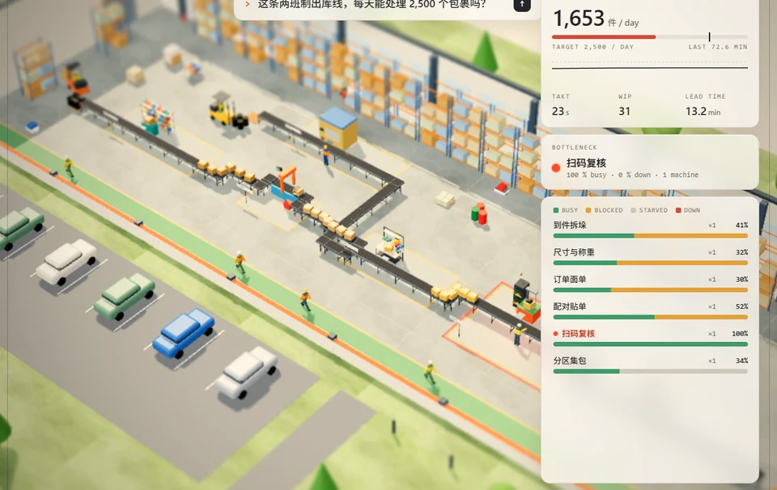

# 让原理动起来 · 科普动画七技实测

七个科普动画工具的小型实验展。用启停逻辑、接触器、机械气缸、包裹出库与冰晶生物实验检验实际用途。

[打开在线展厅](https://yangwei251003.github.io/science-animation-skill-lab/) · [Cooper 说的参考视频](https://www.douyin.com/video/7707669953352076582)

## 实测观察

| 工具 | 展品 | 实测看点 |
|---|---|---|
| [Tinycharts](https://april-zhu.com/tinycharts/) | 《礼物从哪里出发》，本机保留 | 手绘等轴流程、合法与非法事件；Free 9 类，Pro 28 类。免费生成图禁止再分发。 |
| [teardown](https://github.com/elvarofficial/teardown/tree/a91262ac1109051e014662d42ecb0b7bc1f113b1) | [接触器为什么会吸合](teardown/index.html) | 吸合、转动视角与拆解重组；原创教学几何。 |
| [factory-skill](https://github.com/AirsupHQ/factory-skill/tree/9fde7554e6a30e77ea1008dec08f2ba8d8d37f27) | [分拣线卡在哪里](factory/index.html) | 原版离散事件引擎驱动 3D 工位；再加一台扫码设备会把瓶颈转到贴单。 |
| [machine-skill](https://github.com/AirsupHQ/machine-skill/tree/e0bd066ac5beaf48512935de2fc0f0e55636853a) | [一只气缸，两种力](machine/index.html) | 双作用气缸剖视。按有效面积计算的 6 bar 理论力约 483 N / 415 N。模型非生产级。 |
| [SeeCode](https://github.com/Aryanutkarsh/SeeCode/tree/9967db28e86e0e212d4ddf5a60f90fe62f3436c0) | [停机优先](seecode/index.html) | 在一轮 PLC 扫描中追踪停止优先路径，提供 PNG/SVG 导出。 |
| [anatomy](https://github.com/wheresryan22/anatomy/tree/1482e8469b0a9e0d8cc18ea2740a01423d29ae80) | [松开启动，为什么还在转？](anatomy/index.html) | 等轴线稿显示按钮、保持触点和灯；可切换明暗。 |
| [Anima](https://github.com/Garinmckayl/anima/tree/f0249c4fdc94cc854abcff8bf34a087e37145714) | [冰晶边缘的荧光](anima/index.html) | 基于 [Celik 等的微流控实验](https://pmc.ncbi.nlm.nih.gov/articles/PMC3557080/) 切换吸附、冲洗和对照。 |

原视频的高密度机械样本依赖场景建模，本项目用较小的教学结构验证运动、交互和反馈。分拣线参数为虚构教学设定，气缸只做简化理论对照，PLC 示意演示不连接设备。

## 在本机打开

下载仓库，双击根目录的 **index.html**；Three.js 场景使用支持 WebGL 的浏览器。也可以在项目根运行 **python -m http.server 8000**，再打开 **http://localhost:8000**。所有展品提供静态运行文件，基础功能无需后端；SeeCode 的额外导出功能可能加载第三方编码器。

每个展品目录归档了改写的规格或原始实现。Anima 直接运行 **node anima/build.mjs**，加 **--light** 生成浅色版。其他生成器按上表固定版本取得：

- Factory：在上游运行 **node scripts/build.mjs**，输入 **factory/spec.js**，输出展品 HTML。
- SeeCode：将 **seecode/plc-stop.json** 传给上游 **scripts/seecode.mjs render**。详细选项见上游。
- Anatomy：运行 **node anatomy/build.mjs <anatomy 安装目录>**，可加 **--light**。
- Machine：在上游准备 **esbuild** 与 **three@0.170.0**，运行 **node machine/build.mjs <已有依赖的目录> <machine 安装目录>**。
- Teardown：几何、逻辑和样式位于 **teardown/main.js** 与 **teardown/style.css**；以固定版本上游 **sims/build.mjs** 打包。

## 归属与更新

本仓原创部分采用 [MIT](LICENSE)。第三方部分保留各自目录的许可。实际运行截图来自这批展品；未包含第三方原视频、引用截图、源工程和 Tinycharts 免费生成文件。

- **2026-11-14**：首版，归档六个可分发展品的源码、可运行页面、代表图和验证说明。
